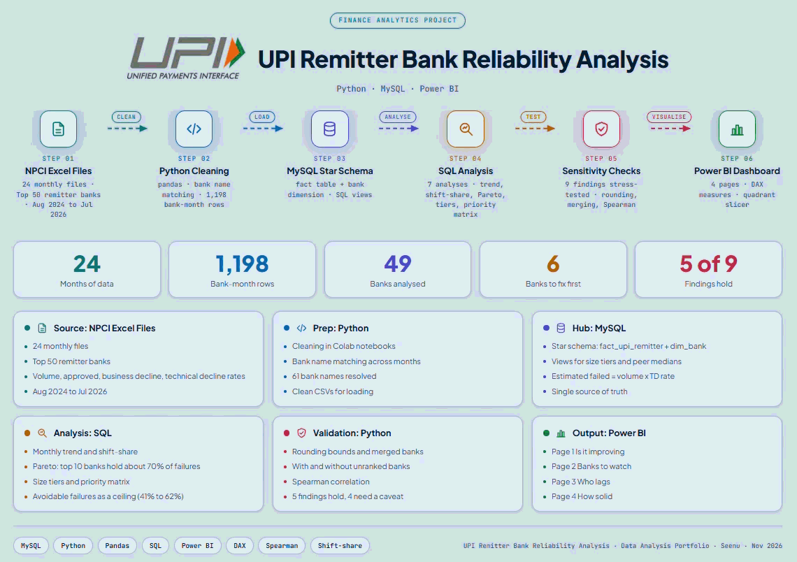
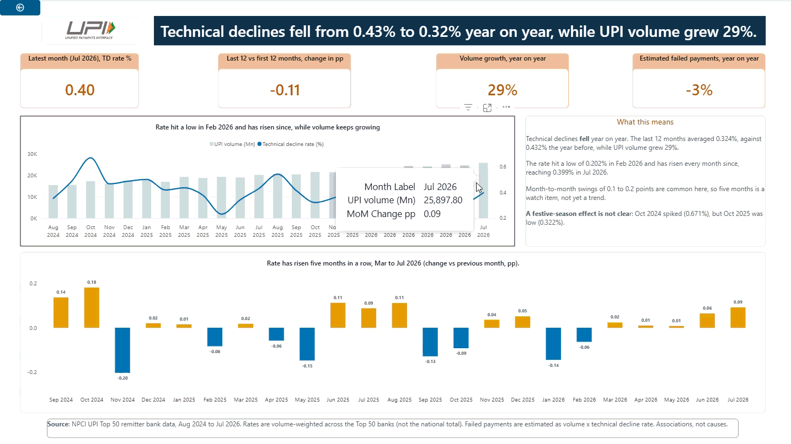
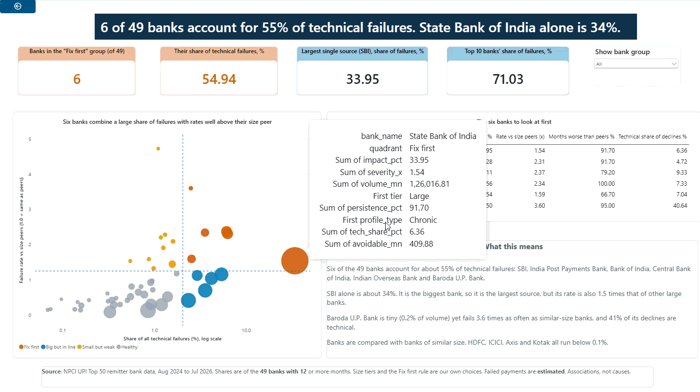
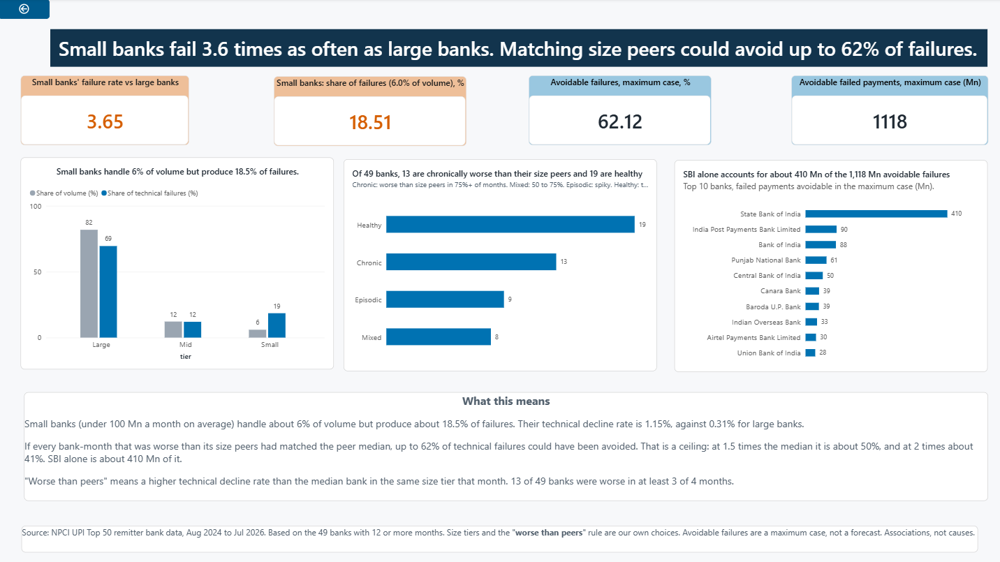
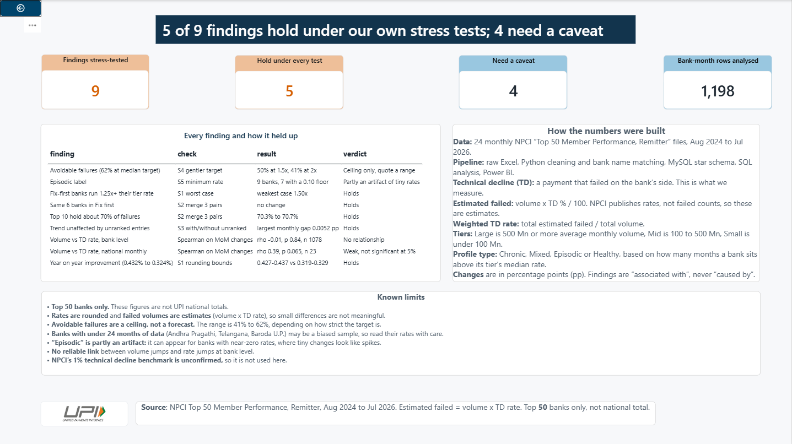

# 🇮🇳 UPI Remitter Bank Reliability Analysis

**Python · MySQL · Power BI**

**Is UPI technical reliability improving, and which banks should we watch first?**
This project answers that using 24 months of NPCI data on the top 50 remitter banks (Aug 2024 to Jul 2026): a cleaning pipeline, a MySQL star schema, seven SQL analyses, nine stress tests of my own findings, and a four-page Power BI dashboard.

<p align="center">
  
</p>

## 🎯 The answer in 30 seconds

| | Finding | Key number |
|---|---|---|
| 📉 | **It is improving.** The technical decline rate fell year on year while volume grew. | 0.43% to 0.32%, volume +29%, estimated failed payments -3% |
| 📈 | **But the last five months rose.** A watch item, not yet a trend, because swings of 0.1 to 0.2 points are normal. | 0.20% (Feb 2026) to 0.40% (Jul 2026) |
| 🏦 | **A few banks matter most.** Six "Fix first" banks hold most technical failures. State Bank of India is the largest source and also fails 1.5 times as often as other large banks. | 6 of 49 banks = 55% of failures, SBI = 34%, top 10 = 71% |
| 🏘️ | **Small banks lag.** They handle a small share of payments but produce a large share of failures. | 6.0% of volume, 18.5% of failures, 3.6 times the large-bank rate |
| 💡 | **The prize is real, but it is a ceiling.** Failures above each bank's size-peer median could be avoided. | Up to 62% avoidable, 41% at a stricter bar |
| 🚦 | **Heavy traffic does not reliably mean more failures.** | Bank level rho -0.01 (no link). National rho 0.39, not significant at 5% |
| 🧪 | **I tested my own results.** 5 of 9 findings hold. 4 need a caveat, and the dashboard says which. | 5 of 9 |

Every finding says "associated with", never "caused by". A **technical decline (TD)** means a payment failed because of a technical problem on the bank's side. Failed payments are **estimated** as volume x TD rate, because NPCI publishes rates, not counts.

## 📊 Dashboard preview

<table>
  <tr>
    <td width="50%"><br><b>1. Is it improving</b></td>
    <td width="50%"><br><b>2. Banks to watch</b></td>
  </tr>
  <tr>
    <td width="50%"><br><b>3. Who lags</b></td>
    <td width="50%"><br><b>4. How solid</b></td>
  </tr>
</table>

📎 Dashboard file: [`powerbi/upi_reliability_dashboard.pbix`](powerbi/upi_reliability_dashboard.pbix)
📄 Full write-up, with every number explained in plain English: [`docs/UPI_Reliability_Report.pdf`](docs/UPI_Reliability_Report.pdf)

## 💡 Business context

UPI is India's instant payment system, run by NPCI. A payment from a customer's bank (the **remitter bank**) can end in three ways:

| Outcome | Share (these 50 banks) | Meaning |
|---|---|---|
| Approved | 91.3% | The payment went through. |
| Business decline (BD) | 8.3% | Failed for a customer-side reason, such as a wrong PIN or low balance. |
| **Technical decline (TD)** | **0.37%** | Failed because of a technical problem on the bank's side. **This is the metric studied here.** |

0.37% sounds small, but across these banks and 24 months it is an estimated **1.82 billion** failed payments out of about 490 billion attempted.

## 🗂️ Data

- **Source:** NPCI, Ecosystem Statistics, UPI, "Top 50 member performance", Remitter tab. One Excel file per month, 24 months.
- **Fields used:** volume (millions of payments), approved %, business decline %, technical decline %.
- **Cleaning:** 3 different file layouts standardised into one table of **1,198 bank-month rows**. 117 bank-name variants resolved to **61 banks**. 6 non-bank or card entities are kept in the data but left out of bank rankings.
- **Checks:** approved + BD + TD adds up to 100%, no duplicate bank-month rows, row counts reconciled between staging and final tables, and a hand check against the source files.
- The 24 monthly NPCI files are in [`raw/`](raw/), renamed by month (for example `upi_2024_08.xlsx`).

## 🧪 Methods

| Business question | Method |
|---|---|
| Is it improving? | Time series, month-on-month change in percentage points |
| Real improvement, or just traffic shifting? | Shift-share (rate-mix) split on a balanced panel of 39 banks |
| Who matters most? | Pareto analysis and concentration ratio |
| Chronic problem, or a bad month? | Persistence and volatility (coefficient of variation) |
| Is the comparison fair? | Size-tier benchmarking (Large, Mid, Small) |
| What do we fix first? | Priority matrix: impact vs severity |
| How big is the prize? | Counterfactual (what-if) against the peer median |
| Does heavy traffic cause failures? | Spearman correlation on month-on-month changes |
| Do the results survive my own choices? | Sensitivity analysis: rounding, merged banks, with and without unranked entries, gentler targets |

**Choices I made, stated openly:**
- Eligible banks are ranked banks with 12 or more months of data (49 banks).
- Size tiers use average monthly volume: Large 500 Mn or more, Mid 100 to 500 Mn, Small under 100 Mn.
- "Fix first" means at least 2.04% of all failures (an equal share across 49 banks) and a rate at least 1.25 times its tier.
- Year on year compares 12 months against 12 months.

## 🛠️ Tech stack

| Stage | Tools |
|---|---|
| Clean and validate | Python (pandas, openpyxl) |
| Store | MySQL (star schema: fact table, bank dimension, views) |
| Analyse | SQL (CTEs, window functions, views), Python (scipy) |
| Visualise | Power BI (star model, DAX measures) |
| Version control | Git and GitHub |

## 📁 Repository structure

```
raw/          The 24 monthly NPCI Excel files
notebooks/    01_loader, 02_bank_mapping, 03_explore_mapped_data, 04_sensitivity_and_correlation
clean/        Cleaned data, the bank name mapping, and the nine stress-test results
sql/          01 to 04: staging, star schema, load checks, reconciliation
              05 to 13: the seven analyses (trend, shift-share, Pareto, profiles, tiers, priority matrix, what-if)
              14: views that feed Power BI
powerbi/      Dashboard (.pbix) and the colour theme (upi_theme.json)
docs/         Project report (PDF) and the images used in this README
```

## ▶️ How to reproduce

1. Run the notebooks in `notebooks/` in order. They read the files in `raw/` and write the cleaned data to `clean/`.
2. In MySQL, load the cleaned data into the staging table (`sql/01_create_staging.sql`), then run the rest of the scripts in `sql/` in numeric order. `09_views.sql` must run before `14_pbi_views.sql`.
3. Open the `.pbix` in Power BI Desktop (it needs **MySQL Connector/NET** on Windows), point the data source to your MySQL server, and click **Refresh**.

## ⚠️ Limits

- **Top 50 banks only.** These figures are not UPI national totals.
- **Rates are rounded and failed volumes are estimates**, so small differences are not meaningful.
- **Avoidable failures are a ceiling, not a forecast.**
- **Banks with under 24 months of data** (Andhra Pragathi 14, Telangana 19, Baroda U.P. 20) may be a biased sample.
- **The "Episodic" label is partly an artifact** of near-zero rates.
- **NPCI's 1% technical decline benchmark is unconfirmed**, so it is not used.

## 👤 Author

**Sonu Saroj (Seenu)**, Pune · [GitHub](https://github.com/Sonusrj)
